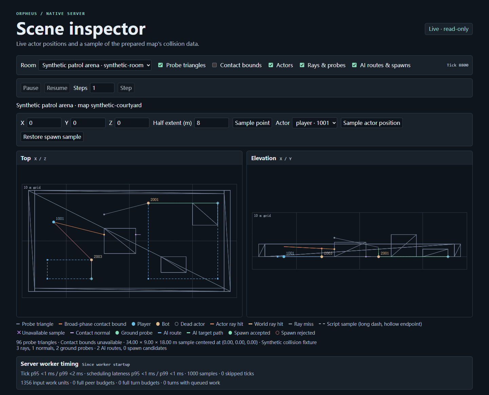
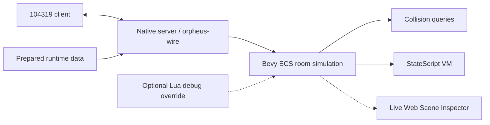

# ORPHEUS

[](https://www.rust-lang.org/)
[](LICENSE)
[](https://github.com/leafall903/ORPHEUS/actions/workflows/public-checks.yml?query=branch%3Arust)
[](https://discord.gg/tqukqjAk7)
[](CONTRIBUTING.md)

[简体中文](README.zh-CN.md) · [Quick start](#public-rust-tests-no-game-files-required) · [Current status](#current-status) · [Contribute](#contributing) · [Discord](https://discord.gg/tqukqjAk7)

**ORPHEUS is an independent, open-source Rust dedicated server reimplementation for Overwatch 1 (retail build 1.74.0.0.104319).** This developer preview supports research and game preservation, with headless regressions for the lobby, Practice Range, and parts of Junkenstein's Revenge.

- **Rust simulation and StateScript.** Bevy ECS runs room simulation, with separate crates for the protocol, collision, runtime data and StateScript VM.
- **Try the source without a game install.** The public workspace suite runs on synthetic fixtures.
- **Live Web Scene Inspector.** Follow actors, AI routes, collision samples and rays in top and elevation views. The timing panel reports worker percentiles from tick and scheduling histograms.

[](docs/assets/scene-inspector.png)

*The project’s Inspector rendered with a synthetic arena and example timing data. [Open the static screenshot](docs/assets/scene-inspector.png).*

**Branches.** [`rust`](https://github.com/leafall903/ORPHEUS/tree/rust) is the GitHub default and the target for active development. [`main`](https://github.com/leafall903/ORPHEUS/tree/main) preserves the unmaintained Python server, launcher, extractors and reference tests. [Branch guide](docs/BRANCH_TRANSITION.md)

## Public Rust Tests (No Game Files Required)

Install **Git** and **stable Rust** (`>= 1.85.0`). On Windows, install the **x64 MSVC Build Tools** and **Windows SDK** for Rust's MSVC toolchain.

```powershell
git clone https://github.com/leafall903/ORPHEUS.git
cd ORPHEUS
cargo test --locked --workspace --all-targets
```

The default build excludes the Lua runtime. The server uses StateScript for patrol decisions. The included patrol graph selects waits and route slots from map-provided waypoints. Rust owns pathfinding, steering, collision and per-tick movement in the room simulation.

<details>
<summary>Optional Lua override and additional checks</summary>

Build with `--features lua-debug` and pass `--ai-script <file>` to use a local Lua override with hot reload. Enabling the feature by itself keeps the StateScript policy.

The [contribution guide](CONTRIBUTING.md) covers Clippy, the optional Inspector and Lua checks, MSRV, and the shared StateScript contracts in public CI.

</details>

---

## Run the Native Server

Starting the native server requires a prepared **base 104319 Practice Range** runtime pack (optionally enriched with Junkenstein data). See [data/README.md](data/README.md) for the full input checklist and packing steps.

```powershell
$env:ORPHEUS_RUNTIME_DIR = 'C:\path\to\authorized-base-runtime'
cargo run --locked --bin orpheus_server -- --check-runtime
cargo run --locked --bin orpheus_server -- --data-dir 'C:\path\to\local-state'
```

### Live Web Scene Inspector

Enable the optional loopback Inspector with `--features inspector`.

```powershell
cargo run --locked --features inspector --bin orpheus_server -- --data-dir 'C:\path\to\local-state' --debug-port 3726
```

Then open `http://127.0.0.1:3726/` to view live room actors, sampled collision geometry, bot patrol clips, worker timing percentiles, and room-fault records.

<details>
<summary>Local Junkenstein validation overrides (Normal Cassidy, card 0x3C)</summary>

For isolated Normal Revenge (`0x3C`) acceptance runs, pass `--junkenstein-validation <path.json>` before startup:

- **High-capacity gate victory check:** `{"invulnerable_cassidy": true, "gate_capacity": 1000000000}`
- **Destructible-gate defeat check:** `{"invulnerable_cassidy": true}`

These overrides apply only to card `0x3C` and do not affect default runs or other heroes/cards. Keep local profile files outside the repository.

</details>

---

## Current Status

| Area | Implemented (`rust`) | Next Steps |
| --- | --- | --- |
| **Login, Profiles & Gallery** | Native Battle.net RPC, JAM lobby, profile settings persistence (`profile-settings-v1`), and Hero Gallery loadout previews (including 23 NPC previews). | Expand lobby flows and polish Hero Gallery framing. |
| **Practice Range & Combat** | Local UDP rooms with Bevy ECS simulation for bots and projectiles. Shared StateScript systems drive patrol decisions and supported weapon and ability behaviors. | Extend shared behavior across the roster, improve movement and ammo synchronization, and refine map navigation. |
| **Junkenstein's Revenge** | All 14 cards load. Headless replays cover supported combat abilities, ultimate charge (`0B8B`), team score, boss speech (`40E05F6B`), and gate stages. | Expand the PvE hero roster and refine boss intro cameras, pursuit, and end-of-match flows. |
| **Architecture & Isolation** | Independent `orpheus-wire`, `orpheus-collision`, `orpheus-runtime`, and `orpheus-statescript` workspace crates, plus modularized `game_combat/`, `scene_assets/`, and `game_service/` with room-level fault and panic isolation. | Extend cross-map navigation and multi-map simulation support. |

See the [architecture](docs/NATIVE_SERVER_ARCHITECTURE.md), [evidence and status](docs/STATE.md), [behavior contracts](docs/BEHAVIOR_CONTRACTS.md), and [roadmap](docs/ROADMAP.md).

---

## Architecture and Workspace Layout



| Path | Role |
| --- | --- |
| `rust/src/` | Main server binary (`orpheus_server`), lobby, match worker, replication, ECS simulation (`game_combat/`), scene prep (`scene_assets/`), and host VM adapters |
| `rust/crates/statescript/` (`orpheus-statescript`) | Portable StateScript graph loader, expression evaluator, codec tables, and decoupled VM core |
| `rust/crates/wire/` (`orpheus-wire`) | JAM cipher, framing, codec readers/writers, game datagrams, commands |
| `rust/crates/collision/` (`orpheus-collision`) | Collision cache reader, spatial triangle index, static rays, GJK/contact solver |
| `rust/crates/runtime/` (`orpheus-runtime`) | Runtime manifest inventory, preflight checks, and `prepare_server_runtime` CLI |
| `rust/scripts/` | StateScript patrol policy and sample Lua debug override |
| `rust/assets/inspector/`, `rust/tests/` | Web Scene Inspector assets and integration test targets (`world_queries`, `profile_settings`, `protocol`, `runtime_preflight`) |
| `fixtures/behavior/`, `scripts/` | JSON behavior fixtures (including Rust-only regressions) and cross-language verifier scripts |
| `relay/` | Windows C++ client TLS relay source |

## Contributing

- **Rust and protocol.** Extend shared weapon and ability behavior and cover delivery of StateScript state to clients. [Example delivery task (#166)](https://github.com/leafall903/ORPHEUS/issues/166)
- **Inspector, navigation and ECS.** Build on the completed work. [#62](https://github.com/leafall903/ORPHEUS/issues/62) · [#63](https://github.com/leafall903/ORPHEUS/issues/63) · [#65](https://github.com/leafall903/ORPHEUS/issues/65)
- **Gameplay feedback.** Share reproducible behavior reports from the Practice Range or Junkenstein's Revenge. [Roadmap](docs/ROADMAP.md)

See the [contribution guide](CONTRIBUTING.md), browse [open issues](https://github.com/leafall903/ORPHEUS/issues?q=is%3Aissue+is%3Aopen), or join [Discord](https://discord.gg/tqukqjAk7).

## License & Credits

The source is [MIT-licensed](LICENSE). Upstream research and contributor credits are documented in [CREDITS.md](CREDITS.md). ORPHEUS is an independent research and preservation project with no affiliation to Blizzard Entertainment. Never commit game clients, commercial assets, signing inputs, keys, credentials, or raw packet captures.
