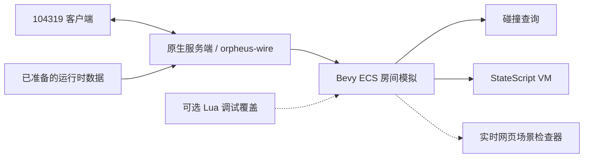

# ORPHEUS

[](https://www.rust-lang.org/)
[](LICENSE)
[](https://github.com/leafall903/ORPHEUS/actions/workflows/public-checks.yml?query=branch%3Arust)
[](https://discord.gg/tqukqjAk7)
[](CONTRIBUTING.md)

[English](README.md) · [快速上手](#运行公开-rust-测试无需游戏本体) · [当前进度](#当前进度) · [参与贡献](#参与贡献) · [Discord](https://discord.gg/tqukqjAk7)

**ORPHEUS 是面向《守望先锋 1》零售版 1.74.0.0.104319 的独立开源 Rust 专用服务端复刻项目。** 项目处于开发预览阶段，面向协议研究和游戏保存。大厅、靶场和怪鼠复仇的部分流程已有无客户端回归。

- **Rust 房间模拟与 StateScript。** Bevy ECS 驱动房间模拟，网络协议、碰撞、运行时数据和 StateScript VM 各有独立 crate。
- **无需安装游戏即可上手。** 公开工作区测试使用合成夹具。
- **实时网页场景检查器（Live Web Scene Inspector）。** 在顶视图和立面图中查看实体、机器人路径、碰撞采样和射线。耗时面板从直方图计算 Tick 与调度延迟的分位数。

[](docs/assets/scene-inspector.png)

*由项目实际的 Inspector 页面渲染。场景和耗时数据均为合成示例。[查看静态截图](docs/assets/scene-inspector.png)。*

**分支。** [`rust`](https://github.com/leafall903/ORPHEUS/tree/rust) 已是 GitHub 默认分支，也是当前的开发分支。[`main`](https://github.com/leafall903/ORPHEUS/tree/main) 保留旧版 Python 服务端、启动器、提取工具和参考测试。Python 版已停止维护。[分支指南](docs/BRANCH_TRANSITION.md)

## 运行公开 Rust 测试（无需游戏本体）

安装 **Git** 与 **稳定版 Rust**（`>= 1.85.0`）。在 Windows 上还需安装 **x64 MSVC C++ Build Tools** 与 **Windows SDK**，供 Rust 的 MSVC 工具链使用。

```powershell
git clone https://github.com/leafall903/ORPHEUS.git
cd ORPHEUS
cargo test --locked --workspace --all-targets
```

默认构建不包含 Lua 运行时。服务端用 StateScript 决定巡逻的等待时长和下一个路点，路点来自地图。Rust 在房间模拟中负责寻路、转向、碰撞和逐帧移动。

<details>
<summary>可选 Lua 覆盖和其他检查</summary>

用 `--features lua-debug` 编译并传入 `--ai-script <文件>`，可启用本地 Lua 覆盖与热重载。仅打开功能开关时仍使用 StateScript。

[贡献指南](CONTRIBUTING.md) 收录 Clippy、Inspector、Lua、最低 Rust 版本和 StateScript 共享契约的检查步骤。

</details>

---

## 启动原生服务端（一键整合启动脚本）

启动原生服务端只需要一份来自你本地合法客户端文件的完整 **1.74.0.0.104319** 运行包（严禁向仓库提交游戏客户端、暴雪资源或密钥）。文件清单见 [data/README.md](data/README.md)。

使用整合脚本可一键完成打包（若提供 `-SourceDir`）、编译发布版 `orpheus_server`（含 `inspector` 与 `lua-mods`）、运行 `--check-runtime` 自检，并自动将玩家皮肤、战利品箱和设置持久化到 `%LOCALAPPDATA%\ORPHEUS\state`：

```powershell
# 双击 scripts\PLAY_ORPHEUS.cmd，或在终端运行：
powershell -ExecutionPolicy Bypass -File scripts\setup_and_play.ps1 -RuntimeDir 'C:\path\to\orpheus-runtime-104319'

# 加载 Lua 5.4 工坊 Mod 启动：
powershell -ExecutionPolicy Bypass -File scripts\setup_and_play.ps1 -RuntimeDir 'C:\path\to\orpheus-runtime-104319' -ModScript rust\scripts\mods\low_gravity_arena.lua
```

<details>
<summary>手动命令行与实时网页场景检查器</summary>

```powershell
$env:ORPHEUS_RUNTIME_DIR = 'C:\path\to\orpheus-runtime-104319'
cargo run --locked --bin orpheus_server -- --check-runtime
cargo run --locked --features inspector,lua-mods --bin orpheus_server -- --data-dir 'C:\path\to\local-state' --debug-port 3726
```

启动后访问 `http://127.0.0.1:3726/`，即可查看实时实体、碰撞网格（含 `/api/debug/v1/collision-compare` 双碰撞对比）、机器人巡逻线路、Tick 耗时分位数以及房间故障隔离记录。

</details>

---

## Lua 5.4 Mod 与工坊脚本支持

使用 `--features lua-mods`（或 `inspector,lua-mods`）编译并传入 `--mod-script <file.lua>`，即可在**沙盒化 Lua 5.4 虚拟机**（`StdLib::NONE`、256 KiB 内存上限、指令预算限制、禁止文件系统/系统/网络访问，支持 `reload` 原子回滚热重载）中自定义游戏规则与事件响应：

- **房间规则：** `damage_scale`、`healing_scale`、`gravity_scale`、`speed_scale`、`ult_charge_scale`、`cooldown_scale`、`friendly_fire`
- **事件钩子：** `on_room_start`、`on_player_spawn`、`on_damage`、`on_kill`、`on_button`、`on_chat`、`on_tick`
- **内置示例：** [`rust/scripts/mods/low_gravity_arena.lua`](rust/scripts/mods/low_gravity_arena.lua) · [`rust/scripts/mods/headshot_only_practice.lua`](rust/scripts/mods/headshot_only_practice.lua)

```lua
return {
    abi = 1,
    info = { name = "Headshot-Only Practice", version = "1.0.0", author = "ORPHEUS" },
    on_damage = function(ctx, event)
        if not event.headshot and not event.melee then
            return { damage = 0.0, actions = {} }
        end
    end,
}
```

服务端控制台输入 `reload` + 回车即可无重启热重载 Mod。

---

## 当前进度

| 模块 | 已实现（`rust`） | 下一步 |
| --- | --- | --- |
| **登录、存档与画廊** | 原生 Battle.net RPC、JAM 大厅、玩家设置持久化（`profile-settings-v1`），以及英雄画廊装备预览（含 23 个 NPC 预览）。 | 扩展大厅流程，优化英雄画廊的镜头构图。 |
| **靶场与战斗** | Bevy ECS 模拟机器人与投射物、镂空栏杆与可破坏物体（`STU_E62A2EFC`）、可互动物体（`room_primitives.rs`）、语音/表情/需要治疗与默认战斗音效，以及全部 32/32 英雄通用启动。 | 推进全部 32 名英雄与多人对局的实机客户端验收。 |
| **PvE 与 PvP 模式** | 统一 `pve_encounter/` 模块（全部 14 张怪鼠复仇卡牌）与可组合 PvP 模式契约（`pvp_mode.rs`：运载/攻防/混合/占领）。 | 扩展 PvE 英雄阵容与联机 PvP 流程。 |
| **底层架构与 Mod 扩展** | `orpheus-wire`/`collision`/`runtime`/`statescript` 独立 crate、Inspector 双碰撞对比接口与沙盒化 Lua 5.4 Mod API（`mod_script.rs`）。 | 将更多 Lua Mod 动作直接接入房间实时物理与技能钩子。 |

更多详情见 [架构与迁移](docs/NATIVE_SERVER_ARCHITECTURE.md) · [进度与对等状态](docs/STATE.md) · [行为契约](docs/BEHAVIOR_CONTRACTS.md) · [路线图](docs/ROADMAP.md)。

---

## 架构与目录结构



| 路径 | 职责 |
| --- | --- |
| `rust/src/` | 主服务端（`orpheus_server`）、大厅与匹配、同步投递、ECS 战斗模拟（`game_combat/`）、场景加载（`scene_assets/`）、StateScript 宿主适配层 |
| `rust/crates/statescript/`（`orpheus-statescript`） | 图加载、表达式求值、编解码表和独立 VM |
| `rust/crates/wire/`（`orpheus-wire`） | JAM 加密流、分帧协议、编解码与输入命令报文 |
| `rust/crates/collision/`（`orpheus-collision`） | 碰撞缓存解码、空间三角索引、射线查询与 GJK/EPA 接触求解器 |
| `rust/crates/runtime/`（`orpheus-runtime`） | 运行时清单校验、`--check-runtime` 自检与 `prepare_server_runtime` 打包工具 |
| `rust/scripts/` | StateScript 巡逻策略和 Lua 调试覆盖示例 |
| `rust/assets/inspector/`、`rust/tests/` | 网页场景检查器与跨模块集成测试（`world_queries`、`profile_settings`、`protocol`、`runtime_preflight`） |
| `fixtures/behavior/`、`scripts/` | JSON 行为夹具（包含仅用于 Rust 的回归契约）及跨语言校验脚本 |
| `relay/` | Windows C++ 客户端 TLS 中继源码 |

## 参与贡献

- **Rust 和协议。** 扩展通用英雄技能，补充 StateScript 状态的客户端投递覆盖。[投递任务示例（#166）](https://github.com/leafall903/ORPHEUS/issues/166)
- **Inspector、导航和 ECS。** 在 [#62](https://github.com/leafall903/ORPHEUS/issues/62)、[#63](https://github.com/leafall903/ORPHEUS/issues/63) 和 [#65](https://github.com/leafall903/ORPHEUS/issues/65) 已完成的工作上继续改进。
- **玩法反馈。** 使用 104319 版本在本地体验靶场或怪鼠复仇，报告可复现的玩法或协议差异。[路线图](docs/ROADMAP.md)

欢迎阅读[贡献指南](CONTRIBUTING.md)、查看[待处理 Issue](https://github.com/leafall903/ORPHEUS/issues?q=is%3Aissue+is%3Aopen)，或加入 [Discord](https://discord.gg/tqukqjAk7)。

## 许可与声明

源码采用 [MIT 协议](LICENSE)，贡献者与致谢见 [CREDITS.md](CREDITS.md)。ORPHEUS 是独立研究与游戏保存项目，与暴雪娱乐无隶属关系。严禁向公开仓库提交游戏客户端、商业资源、签名输入、密钥、账号数据或原始网络抓包。
