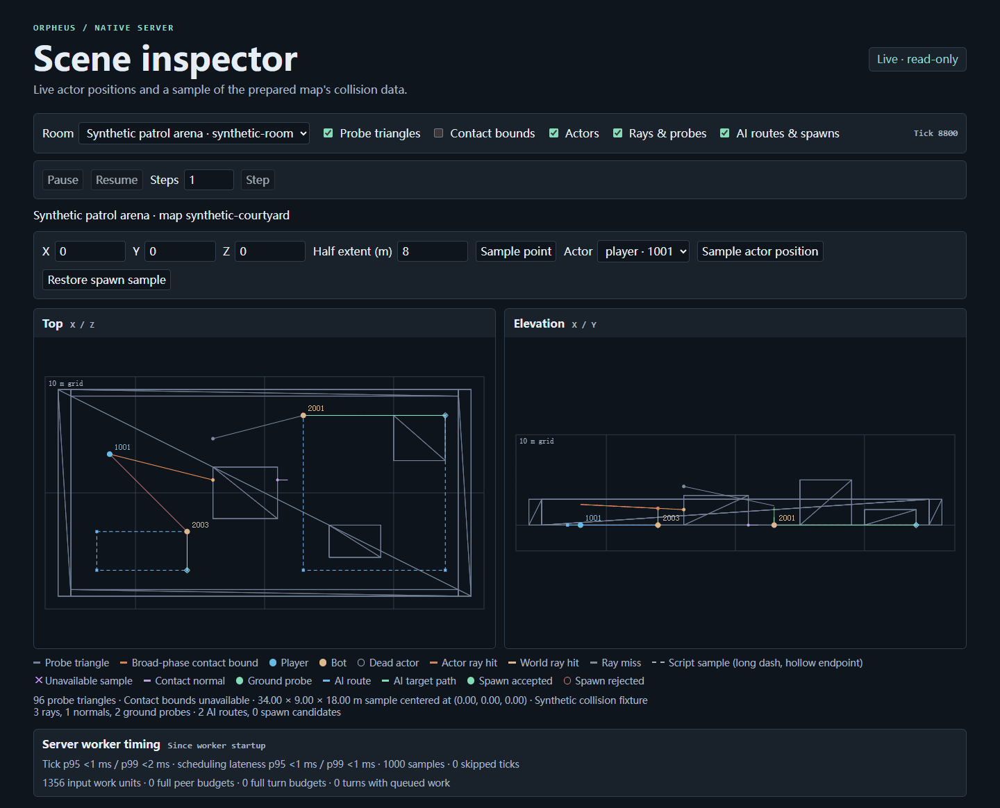
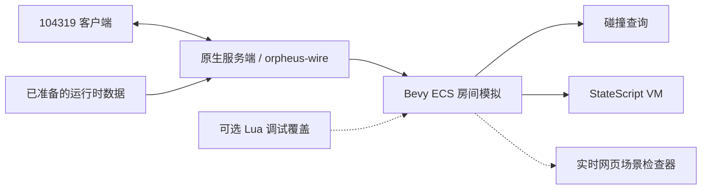

# ORPHEUS

[](https://www.rust-lang.org/)
[](LICENSE)
[](https://github.com/leafall903/ORPHEUS/actions/workflows/public-checks.yml?query=branch%3Arust)
[](https://discord.gg/tqukqjAk7)
[](CONTRIBUTING.md)

[English](README.md) · [快速上手](#运行公开-rust-测试无需游戏本体) · [当前进度](#当前进度) · [参与贡献](#参与贡献) · [Discord](https://discord.gg/tqukqjAk7)

**ORPHEUS 是面向《守望先锋 1》零售版 1.74.0.0.104319 的独立开源 Rust 专用服务端复刻项目。** 项目处于开发预览阶段，面向协议研究和游戏保存。大厅、靶场和怪鼠复仇的部分流程已有无客户端回归。

- **Rust 房间模拟与 StateScript。** Bevy ECS 驱动房间模拟，网络协议、碰撞、运行时数据和 StateScript VM 各有独立 crate。
- **无需安装游戏即可上手。** 公开工作区测试使用合成夹具。
- **实时网页场景检查器（Live Web Scene Inspector）。** 在顶视图和立面图中查看实体、机器人路径、碰撞采样和射线。耗时面板从直方图计算 Tick 与调度延迟的分位数。

[](docs/assets/scene-inspector.png)

*由项目实际的 Inspector 页面渲染。场景和耗时数据均为合成示例。[查看静态截图](docs/assets/scene-inspector.png)。*

**分支。** [`rust`](https://github.com/leafall903/ORPHEUS/tree/rust) 已是 GitHub 默认分支，也是当前的开发分支。[`main`](https://github.com/leafall903/ORPHEUS/tree/main) 保留旧版 Python 服务端、启动器、提取工具和参考测试。Python 版已停止维护。[分支指南](docs/BRANCH_TRANSITION.md)

## 运行公开 Rust 测试（无需游戏本体）

安装 **Git** 与 **稳定版 Rust**（`>= 1.85.0`）。在 Windows 上还需安装 **x64 MSVC C++ Build Tools** 与 **Windows SDK**，供 Rust 的 MSVC 工具链使用。

```powershell
git clone --branch rust https://github.com/leafall903/ORPHEUS.git
cd ORPHEUS
cargo test --locked --workspace --all-targets
```

默认构建不包含 Lua 运行时。服务端用 StateScript 决定巡逻的等待时长和下一个路点，路点来自地图。Rust 在房间模拟中负责寻路、转向、碰撞和逐帧移动。

<details>
<summary>可选 Lua 覆盖和其他检查</summary>

用 `--features lua-debug` 编译并传入 `--ai-script <文件>`，可启用本地 Lua 覆盖与热重载。仅打开功能开关时仍使用 StateScript。

[贡献指南](CONTRIBUTING.md) 收录 Clippy、Inspector、Lua、最低 Rust 版本和 StateScript 共享契约的检查步骤。

</details>

---

## 启动原生服务端

启动原生服务端需要先准备一份**基础 104319 靶场运行包**（可选包含怪鼠复仇数据），文件清单与打包步骤见 [data/README.md](data/README.md)。

```powershell
$env:ORPHEUS_RUNTIME_DIR = 'C:\path\to\authorized-base-runtime'
cargo run --locked --bin orpheus_server -- --check-runtime
cargo run --locked --bin orpheus_server -- --data-dir 'C:\path\to\local-state'
```

### 实时网页场景检查器

使用 `--features inspector` 启用本地检查器。

```powershell
cargo run --locked --features inspector --bin orpheus_server -- --data-dir 'C:\path\to\local-state' --debug-port 3726
```

启动后访问 `http://127.0.0.1:3726/`，即可查看实时实体、碰撞网格、机器人巡逻线路与阻挡位置、Tick 耗时分位数以及房间异常故障隔离记录。

<details>
<summary>本地怪鼠复仇验收配置（普通难度卡西迪，卡牌 0x3C）</summary>

仅在本地做普通难度复仇（`0x3C`）验收测试时，可通过 `--junkenstein-validation <path.json>` 加载本地规则覆盖：

- **城门超高血量胜利测试**：`{"invulnerable_cassidy": true, "gate_capacity": 1000000000}`
- **可摧毁城门失败测试**：`{"invulnerable_cassidy": true}`

该配置仅对 `0x3C` 卡牌生效，不影响默认启动或其它英雄/难度，测试配置文件请保存在仓库外。

</details>

---

## 当前进度

| 模块 | Rust 服务端现状 | 104319 原版客户端情况与待办 |
| --- | --- | --- |
| **登录、存档与画廊** | 原生 Battle.net / JAM 大厅、玩家设置持久化（`profile-settings-v1`）、饰品与 23 个 NPC 英雄画廊预览策略。 | 登录与靶场进图已跑通；最新 NPC 画廊预览与完整实机流程待复测。 |
| **靶场与士兵 76** | 加密 UDP 房间、Bevy ECS Bot/投射物管理、StateScript 巡逻策略、步枪/换弹/疾跑/螺旋飞弹/生物力场仿真与靶场重生。 | 无客户端加密回环全部通过；客户端武器挂载、HUD 同步与二楼巡逻细节待实机复测。 |
| **怪鼠复仇与卡西迪** | 全部 14 张卡牌初始化完成；普通难度卡西迪左/右键、翻滚、闪光弹、午时已到、`0B8B` 充能、计分、Boss 语音与城门阶段已通过离线回放。 | 已实机确认失败结算标题；卡西迪全部技能手感、Boss 登场镜头/追击、结算耗时与自然胜利待实机验收。 |
| **底层架构与隔离** | `orpheus-wire`、`orpheus-collision`、`orpheus-runtime`、`orpheus-statescript` 已独立成 crate；`game_combat/`、`scene_assets/`、`game_service/` 完成模块化拆分及房间级 Panic 隔离。 | 跨地图导航与实机行为的后续验收见路线图。 |

更多详情见 [架构与迁移](docs/NATIVE_SERVER_ARCHITECTURE.md) · [进度与对等状态](docs/STATE.md) · [行为契约](docs/BEHAVIOR_CONTRACTS.md) · [路线图](docs/ROADMAP.md)。

---

## 架构与目录结构



| 路径 | 职责 |
| --- | --- |
| `rust/src/` | 主服务端（`orpheus_server`）、大厅与匹配、同步投递、ECS 战斗模拟（`game_combat/`）、场景加载（`scene_assets/`）、StateScript 宿主适配层 |
| `rust/crates/statescript/`（`orpheus-statescript`） | 图加载、表达式求值、编解码表和独立 VM |
| `rust/crates/wire/`（`orpheus-wire`） | JAM 加密流、分帧协议、编解码与输入命令报文 |
| `rust/crates/collision/`（`orpheus-collision`） | 碰撞缓存解码、空间三角索引、射线查询与 GJK/EPA 接触求解器 |
| `rust/crates/runtime/`（`orpheus-runtime`） | 运行时清单校验、`--check-runtime` 自检与 `prepare_server_runtime` 打包工具 |
| `rust/scripts/` | StateScript 巡逻策略和 Lua 调试覆盖示例 |
| `rust/assets/inspector/`、`rust/tests/` | 网页场景检查器与跨模块集成测试（`world_queries`、`profile_settings`、`protocol`、`runtime_preflight`） |
| `fixtures/behavior/`、`scripts/` | JSON 行为夹具（包含仅用于 Rust 的回归契约）及跨语言校验脚本 |
| `relay/` | Windows C++ 客户端 TLS 中继源码 |

## 参与贡献

- **Rust 和协议。** 补齐士兵 76 StateScript 投递覆盖。[待办 #166](https://github.com/leafall903/ORPHEUS/issues/166)
- **Inspector、导航和 ECS。** 已完成的 [#62](https://github.com/leafall903/ORPHEUS/issues/62)、[#63](https://github.com/leafall903/ORPHEUS/issues/63) 和 [#65](https://github.com/leafall903/ORPHEUS/issues/65) 可作为后续改进的参考。
- **原版客户端测试。** 用本地 104319 客户端复测靶场巡逻和碰撞、士兵 76 疾跑和弹药同步，或怪鼠复仇流程。[实机验收清单](docs/ROADMAP.md#original-client-acceptance-gates)

欢迎阅读[贡献指南](CONTRIBUTING.md)、查看[待处理 Issue](https://github.com/leafall903/ORPHEUS/issues?q=is%3Aissue+is%3Aopen)，或加入 [Discord](https://discord.gg/tqukqjAk7)。

## 许可与声明

源码采用 [MIT 协议](LICENSE)，贡献者与致谢见 [CREDITS.md](CREDITS.md)。ORPHEUS 是独立研究与游戏保存项目，与暴雪娱乐无隶属关系。严禁向公开仓库提交游戏客户端、商业资源、签名输入、密钥、账号数据或原始网络抓包。
